# Awesome-API-Gateway-Security 🛡️ 🔗

  

  
  
  
  
  

---

## 🌟 Top API Gateway Security Ecosystem

**Curated List of Commercial API Gateway Platforms & Open-Source Security Tools**  
*Focused on API Discovery, Runtime Protection, Rate Limiting, Bot Defense, API Posture Management, WAF Integration, OAuth2/OIDC, and Self-Hosted Cloud-Native Gateway Security*

**Last updated: October 2026** 📅

---

### 📌 Overview & SEO Summary

Welcome to the ultimate curated directory of **API gateway security platforms**, **open-source API protection tools**, **WAF reverse proxies**, and **runtime API defense frameworks**. Whether you are evaluating enterprise-grade commercial SaaS solutions (such as *AWS API Gateway*, *Google Apigee X*, *Cloudflare API Shield*, *Salt Security*, and *Kong Konnect*), or self-hostable open-source alternatives (like *Traefik*, *Envoy Proxy*, *Kong Gateway*, *Apache APISIX*, *Netflix Zuul*, and *Tyk*), this guide covers category leaders, automated API discovery, OWASP API Top 10 mitigation, OAuth2/OIDC enforcement, mTLS zero-trust architectures, and privacy-respecting runtime API protection.

**Key Market Context:**
- **Market Dynamics:** The API Security market is valued at **~$1.26 Billion in 2026** (with the broader API Management market exceeding **$13.5 Billion**), characterized as **highly fragmented and competitive** across hyperscalers, cloud-edge CDNs, and dedicated cybersecurity pure-plays rather than a winner-take-all monopoly.
- **Apache APISIX** is the **most feature-complete open-source gateway** with **100+ plugins**, **native MCP support for AI agents**, and **full Apache-2.0 licensing with no feature gating**.
- **Kong Gateway OSS** is the **plugin breadth leader** with **100+ plugins**, though enterprise features like OIDC require Konnect Enterprise or paid licensing.
- **Tyk Gateway** is **MPL 2.0 licensed** — **file-level copyleft** that permits proprietary plugins — with **10,800+ GitHub_Stars** and **5M+ DockerHub pulls**.
- **Cloudflare API Shield** integrates ML-based API discovery, schema validation, and mTLS at edge scale, with API Discovery starting on the **$250/month Business tier (as an add-on)** and full posture management on **Enterprise**.
- **Apigee X** subscription starts at **$1,500/month** (Standard tier, Pay-as-you-go proxy units) with **$40K–$60K+ professional services** for implementation.
- **AWS API Gateway HTTP APIs** cost **$1.00 per million requests** vs **REST APIs at $3.50 per million** — offering a **71% cost reduction**.
- **KrakenD CE** is the **only open-source gateway with zero database dependency** — **stateless, declarative, +70K reqs/s on a single instance, under 50MB memory**.
- **kgateway** provides a **dual control plane for Envoy and agentgateway**, **MCP tool federation**, and **AI Gateway guardrails for LLM workloads**.

---

## 📑 Table of Contents

- [🏢 SaaS & Commercial Platforms](#-saas--commercial-platforms)
- [🔓 Open-Source GitHub Projects](#-open-source-github-projects)
- [🛠️ How to Contribute](#%EF%B8%8F-how-to-contribute)
- [📊 Star History](#-star-history)
- [🤝 Support & Sponsorship](#-support--sponsorship)
- [⚠️ Disclaimer](#%EF%B8%8F-disclaimer)

---

## 🏢 SaaS & Commercial Platforms

> **Market Sizing & Structure**: The global API Security market is estimated at **$1.26 Billion in 2026** (scaling within a broader **$13.5 Billion** API Management sector) and remains **highly fragmented and competitive**, driven by diverse enterprise architectures spanning hyperscalers, edge CDNs, and specialized API protection specialists rather than a single winner-take-all platform.

| SaaS / Commercial Platform | Company / Owner | Valuation / Market Cap | Pricing | Free Tier / Trial Limits | Description |
| :--- | :--- | :--- | :--- | :--- | :--- |
| **[AWS API Gateway](https://aws.amazon.com/api-gateway/)** ☁️ | Amazon | ~$2.0 Trillion (Market Cap) | **HTTP APIs: $1.00/million requests** (first 300M); **REST APIs: $3.50/million requests** | **Free Forever: 1M API calls/month for 12 months** (AWS Free Tier) | **Hyperscaler API gateway** — Managed ingress with throttling, IAM auth, and VPC links. HTTP APIs cut costs by 71% compared to REST APIs. |
| **[Apigee X](https://cloud.google.com/apigee)** 🔵 | Google (Alphabet) | ~$2.0 Trillion (Market Cap) | **Pay-As-You-Go from $1,500/month** (Standard org base + $20/M proxy calls; Extensible: $100/M) | **60-day free trial with $300 GCP credits** | **Enterprise API lifecycle & management platform** — Advanced policy enforcement, developer portal, analytics, and security posture monitoring. |
| **[Salesforce MuleSoft Flex Gateway](https://www.mulesoft.com/)** ☁️ | Salesforce | ~$250 Billion (Market Cap) | **$4,800/vCore/year** (List price entry; $3,200–$4,400 negotiated) | **30-day free trial** of Anypoint Platform (Flex Gateway included) | **Enterprise integration gateway** — Lightweight, ultrafast gateway running on Kubernetes/VMs; manages and secures APIs across any distributed environment. |
| **[Cloudflare API Shield](https://www.cloudflare.com/api-shield/)** 🟠 | Cloudflare Inc. | ~$30 Billion (Market Cap) | **$250/month** (Business Plan base + API Shield add-on); Enterprise for full discovery | **Free Tier: Basic schema validation & endpoint protection included on Free plan**; Pro starts at $25/month | **Edge API protection & discovery** — Schema validation, sequence mitigation, volumetric DDoS defense, and ML-based API discovery across global edge points. |
| **[Akamai Noname Security](https://nonamesecurity.com/)** 🔵 | Akamai Technologies | ~$14.5 Billion (Market Cap) | **Starting at ~$35,000/year** (Annual subscription based on protected API traffic volume) | **30-day guided POC / Interactive sandbox demo** | **API security posture & runtime defense** — Proactive posture management, automated API discovery, shadow API detection, and active runtime protection. |
| **[Kong Konnect](https://konghq.com/)** 🦍 | Kong Inc. | ~$2.0 Billion (Valuation) | **$25/month base** (Konnect Plus tier; includes 1M requests, then $200/million) | **30-day free trial of Konnect Plus** (Kong Gateway OSS is free forever) | **Managed API gateway control plane** — Multi-cloud API gateway platform with 100+ security and routing plugins, OIDC authentication, and developer portal. |
| **[Salt Security](https://salt.security/)** 🧂 | Salt Security | ~$1.4 Billion (Valuation) | **Starting at ~$25,000/year** (Tiered annual subscription based on API call volume) | **14-day guided sandbox demo & security assessment trial** | **Patented API protection platform** — Uses cloud-scale big data and AI to discover all APIs, prevent runtime attacks, and fix posture vulnerabilities. |
| **[Cequence Security](https://www.cequence.ai/)** 🎯 | Cequence Security | ~$313 Million (Valuation) | **Starting at ~$30,000/year** (Tiered annual contract based on protected transaction volume) | **14-day guided proof-of-value trial & live interactive demo** | **Unified API Protection (UAP)** — Combines API discovery, API posture management, and behavioral AI bot/fraud mitigation into a single pane of glass. |
| **[Tyk Cloud](https://tyk.io/)** 🎯 | Tyk | ~$150 Million (Valuation) | **$79/month** (Developer Cloud plan) | **Free Forever: 5 Million API calls/month** on Tyk Hybrid/Self-Managed; 14-day trial for Tyk Cloud | **Managed cloud & hybrid API gateway** — Native support for REST, GraphQL, gRPC, and MCP with zero lock-in and open-source foundation. |

---

## 🔓 Open-Source GitHub Projects

*Sorted by GitHub_Stars_Count (Descending)* 🌟

- **[Traefik](https://github.com/traefik/traefik)**   
  **The Cloud Native Application Proxy**, MIT licensed.  
  Written in Go with native auto-discovery integrations for Docker, Kubernetes Ingress/Gateway API, Consul, and Nomad. Features automated TLS certificate generation via Let's Encrypt (ACME), comprehensive middleware chaining for JWT/Basic auth, circuit breakers, IP whitelisting, and distributed tracing. 🚦

- **[Kong Gateway](https://github.com/Kong/kong)**   
  **The Cloud-Native API Gateway**, Apache-2.0 licensed.  
  Built on NGINX/OpenResty with support for PostgreSQL or DB-less declarative YAML configuration. Offers an ecosystem of 100+ plugins for rate limiting, HMAC/JWT authentication, bot detection, ACL, and CORS. The industry standard for microservice ingress and API lifecycle management. 🦍

- **[Envoy Proxy](https://github.com/envoyproxy/envoy)**   
  **Cloud-Native High-Performance Edge/Middle/Service Proxy**, Apache-2.0 licensed.  
  Graduated CNCF project powering Istio and modern service meshes. Employs a high-throughput C++ filter-chain architecture, dynamic xDS configuration APIs, L7 routing, mTLS enforcement, and WebAssembly (Wasm) extensibility. 🔷

- **[Apache APISIX](https://github.com/apache/apisix)**   
  **The Cloud-Native API Gateway and AI Gateway**, Apache-2.0 licensed.  
  Apache Software Foundation top-level project built on NGINX and LuaJIT with etcd dynamic sync. Features 100+ built-in plugins with zero feature gating: Wolf-RBAC, Casbin, Keycloak, OpenID Connect, anti-ReDoS, dynamic rate limiting, and native Model Context Protocol (MCP) support for AI agents. 🚀

- **[Netflix Zuul](https://github.com/Netflix/zuul)**   
  **Gateway Service for Routing, Monitoring, Resiliency & Security**, Apache-2.0 licensed.  
  Netflix's battle-tested edge gateway built on Netty non-blocking I/O. Provides dynamic filter pipelines for request authentication, traffic shaping, DDoS mitigation, and cross-region routing at massive scale. 🎬

- **[Tyk Gateway](https://github.com/TykTechnologies/tyk)**   
  **Open-Source API & AI Gateway**, MPL-2.0 licensed.  
  Written in Go with native support for REST, GraphQL, TCP, gRPC, and Model Context Protocol (MCP). Features built-in quota tracking, HMAC/OAuth2 security, webhook validation, and extensible Python/JS/Go middleware. 🎯

- **[kgateway](https://github.com/kgateway-dev/kgateway)**   
  **Cloud-Native Kubernetes Gateway API & AI Gateway**, Apache-2.0 licensed.  
  CNCF Sandbox project (formerly Gloo Gateway) featuring a dual control plane for Envoy and agentgateway. Enables MCP tool federation, prompt guardrails, and unified traffic governance for microservices and AI agent teams. ☸️

- **[Spring Cloud Gateway](https://github.com/spring-cloud/spring-cloud-gateway)**   
  **Non-Blocking API Gateway built on Spring WebFlux & Project Reactor**, Apache-2.0 licensed.  
  The leading API gateway in the Java enterprise ecosystem. Features declarative route matching, security filter integration with Spring Security (OAuth2/OIDC), Redis-backed rate limiting, and resilience filters via Resilience4j. 🍃

- **[Emissary-Ingress](https://github.com/emissary-ingress/emissary)**   
  **Kubernetes-Native API Gateway built on Envoy Proxy**, Apache-2.0 licensed.  
  CNCF Incubating project (formerly Ambassador). Integrates with Kubernetes CRDs to provide declarative self-service routing, external authentication filters, OAuth2/OIDC integration, and rate limiting for microservice architectures. 🛡️

- **[Zalando Skipper](https://github.com/zalando/skipper)**   
  **Extensible HTTP Router and Reverse Proxy for Service Composition**, Apache-2.0 licensed.  
  Battle-proven in production at Zalando processing billions of daily requests. Acts as an advanced Kubernetes Ingress controller with dynamic routing rules (eskip), OAuth2 token validation, circuit breaking, and blue-green canary deployments. 🦘

- **[KrakenD Community Edition](https://github.com/krakend/krakend-ce)**   
  **Ultra-High Performance Stateless Declarative API Gateway**, Apache-2.0 licensed.  
  Stateless Go-based gateway requiring zero database or coordination layer. Capable of +70,000 requests/sec with under 50MB RAM. Features Backend-for-Frontend (BFF) request aggregation, response filtering, and JWT validation. ⚡

- **[Couper](https://github.com/coupergateway/couper)**   
  **Lightweight API Gateway & Access Control Proxy for Developers**, MIT licensed.  
  Designed for developer ergonomics with declarative HCL configuration. Provides unified access control including Basic Auth, JWT, SAML2, OAuth2, OpenID Connect, and mutual TLS (mTLS) upstream verification. 🛠️

- **[voidrunner3074/aastro](https://github.com/voidrunner3074/aastro)**   
  **Extensible API Gateway in Go with Parallel Fan-Out**, Apache-2.0 licensed.  
  Features declarative YAML configuration, parallel upstream fan-out strategies (`merge`, `array`, `namespaced`), per-upstream circuit breakers, and partial error recovery (`206 Partial Content`). ⚡

- **[STOA Platform](https://github.com/stoa-platform/stoa)**   
  **AI-Native API Gateway for the Model Context Protocol (MCP)**, Apache-2.0 licensed.  
  Purpose-built for secure AI agent access to enterprise APIs and operational tools. Features multi-tenant RBAC isolation, ArgoCD GitOps integration, and 35+ operational MCP tool connectors. 🤖

---

## 🛠️ How to Contribute

Contributions are welcome! Follow these steps to submit new API gateway security platforms or open-source API protection software:

1. 🍴 **Fork** the repository.
2. 📝 **Add/edit** entries in `README.md` maintaining table/list structure and formatting.
3. 🔗 Include project title, official website/GitHub link, exact Stars_Count badge, license, and brief description.
4. 🚀 Submit a **Pull Request** with a descriptive summary of your changes.

---

## 📊 Star History

---

## 🤝 Support & Sponsorship

If you find this API gateway security repository useful, please consider supporting the project:

- ⭐ **Star** this repository to increase visibility!
- 🔀 **Fork** and share with fellow API engineers, security teams, and open-source advocates.
- ☕ **Sponsor & Buy Me a Coffee**: Support ongoing open-source curation via the [GitHub Sponsor Dashboard](https://github.com/sponsors/ishandutta2007).

---

## ⚠️ Disclaimer

- This is a **community-curated** list — not exhaustive and not an endorsement. ℹ️
- **Kong Gateway OSS is Apache-2.0, but OIDC and advanced plugins are Enterprise-only** . **Apache APISIX is fully Apache-2.0 with no feature gating** — the **most permissively licensed enterprise-grade gateway** . **Tyk Gateway is MPL-2.0 and free forever** .
- **Apigee X is expensive and complex** — **$40K–$60K+ professional services** for implementation, **10–50ms added latency per call**, and **GCP infrastructure costs billed separately** . **AWS API Gateway HTTP APIs cost 71% less than REST APIs** — **choose HTTP unless you need WAF, caching, or usage plans** .
- **MuleSoft entry tier commits to 4–10 vCores at $4,800–$6,200/vCore/year** — **Flex Gateway is licensed per gateway node, not per vCore**, and **many buyers use it to move gateway burn off the vCore pool** . **Budget 30–50% above license for implementation, training, and connectors** .
- **Open-source gateways are not turnkey** — **Kong requires PostgreSQL or DB-less configuration and plugin management** . **APISIX requires etcd and plugin configuration** . **KrakenD requires declarative JSON and Go binary deployment** . **Always validate gateway security, performance, and failover with a proof-of-concept** before production deployment. 🔗

---

  <b>Made with ❤️ for API engineers, security teams, and open-source gateway advocates.</b>

